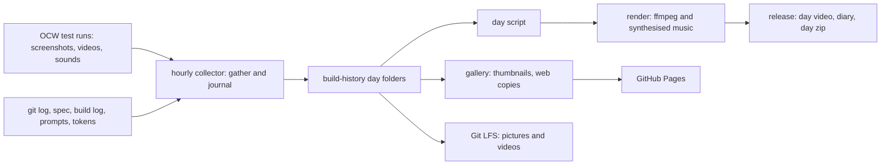

<!-- The README is generated: `make readme` (diary.py readme) fills this
     template (docs/readme/README.template.md) with the hero, the totals, the
     evolution strip (docs/readme/evolution.toml) and one section per build
     day from the day scripts and journals. Edit the template, not README.md. -->
# OCW Build Diary

**The art project of [Open Cycling World](https://github.com/newkit/OCW).**
OCW is built by a human and a crowd of AI agents, day and night.
The OCW Build Diary keeps *everything* that was made on the way: every
screenshot, video, sound, log, commit, merge and test. From it, each build
day becomes a short video (title, a time-lapse of the whole day, the story in
chapters, today's features, the numbers), and the days are joined into one
growing diary video.

<p align="center"><a href="https://github.com/newkit/OCW-ART/releases/download/build-history/ocw-build-diary.mp4"></a></p>

**▶ [Watch the whole diary](https://github.com/newkit/OCW-ART/releases/download/build-history/ocw-build-diary.mp4)** ·
**[Browse the gallery](https://newkit.github.io/OCW-ART/)** (every picture and video, day by day) ·
[Day zips and videos](https://github.com/newkit/OCW-ART/releases/tag/build-history) ·
[The brief and the rules](docs/ART-PROJECT.md)

**6 build days** · **720** commits · **2258** pictures · **189** videos · **8.66 billion** tokens · the diary video: 341.3 MB

## How the game grew

<table><tr><td align="center" valign="top" width="25%"><a href="https://newkit.github.io/OCW-ART/days/2026-11-11/#1"></a><br><sub>Day 1, 01:28 – capsule riders on a green test field</sub></td><td align="center" valign="top" width="25%"><a href="https://newkit.github.io/OCW-ART/days/2026-11-11/#93"></a><br><sub>Day 1 – the first real world: a road in Liechtenstein</sub></td><td align="center" valign="top" width="25%"><a href="https://newkit.github.io/OCW-ART/days/2026-11-12/#375"></a><br><sub>Day 2 – the glow-up: riders with bodies, a peloton climbs</sub></td><td align="center" valign="top" width="25%"><a href="https://newkit.github.io/OCW-ART/days/2026-11-12/#386"></a><br><sub>Day 2 – the Black Forest: the Schauinsland climb</sub></td></tr></table>
<table><tr><td align="center" valign="top" width="25%"><a href="https://newkit.github.io/OCW-ART/days/2026-11-13/#464"></a><br><sub>Day 3 – Tenerife, the Teide found at last</sub></td><td align="center" valign="top" width="25%"><a href="https://newkit.github.io/OCW-ART/days/2026-11-14/#1"></a><br><sub>Day 4 – Unicorn mode: flying over Vaduz</sub></td><td align="center" valign="top" width="25%"><a href="https://newkit.github.io/OCW-ART/days/2026-11-14/#364"></a><br><sub>Day 4 – the seasons: autumn above Vaduz</sub></td><td align="center" valign="top" width="25%"><a href="https://newkit.github.io/OCW-ART/days/2026-11-14/#158"></a><br><sub>Day 4 – the weather: a thunderstorm on Tenerife</sub></td></tr></table>
<table><tr><td align="center" valign="top" width="25%"><a href="https://newkit.github.io/OCW-ART/days/2026-11-14/#78"></a><br><sub>Day 4 – the browser app: the same ride in Chromium</sub></td><td align="center" valign="top" width="25%"><a href="https://newkit.github.io/OCW-ART/days/2026-11-15/#367"></a><br><sub>Day 5 – vegetation: vineyards above Vaduz</sub></td></tr></table>

## The build days

### Day 6 · 2026-11-16 — (the day's story is written at the end of the day)

[Gallery](https://newkit.github.io/OCW-ART/days/2026-11-16/) · day zip and video: at the end of the day

**0** commits · **0** merges · **0** pictures · **0** videos · music: synthwave

### Day 5 · 2026-11-15 — Bananas, a second pair of eyes and a house move

*In which the hills grow vineyards and banana groves, riders learn to put a foot down – and the whole diary packs its bags.*

<table><tr><td align="center" valign="top"><a href="https://github.com/newkit/OCW-ART/releases/download/build-history/ocw-diary-day-05-2026-11-15.mp4"></a><br>▶ <a href="https://github.com/newkit/OCW-ART/releases/download/build-history/ocw-diary-day-05-2026-11-15.mp4">day video</a> (61.1 MB)</td><td align="center" valign="top"><a href="https://newkit.github.io/OCW-ART/days/2026-11-15/#324"></a></td><td align="center" valign="top"><a href="https://newkit.github.io/OCW-ART/days/2026-11-15/#524"></a></td><td align="center" valign="top"><a href="https://newkit.github.io/OCW-ART/days/2026-11-15/#689"></a></td></tr></table>

[Gallery](https://newkit.github.io/OCW-ART/days/2026-11-15/) · [▶ Day video](https://github.com/newkit/OCW-ART/releases/download/build-history/ocw-diary-day-05-2026-11-15.mp4) · [⇩ Day zip](https://github.com/newkit/OCW-ART/releases/download/build-history/ocw-build-history-2026-11-15.zip) (502.8 MB)

**149** commits · **39** merges · spec 3.36 → 3.74 · **731** pictures · **9** videos · **1.66 billion** tokens · music: house

### Day 4 · 2026-11-14 — The weather, the seasons and the 404

*In which Storm Lothar returns, the leaves turn, the browser learns to sing – and one URL leads nowhere.*

<table><tr><td align="center" valign="top"><a href="https://github.com/newkit/OCW-ART/releases/download/build-history/ocw-diary-day-04-2026-11-14.mp4"></a><br>▶ <a href="https://github.com/newkit/OCW-ART/releases/download/build-history/ocw-diary-day-04-2026-11-14.mp4">day video</a> (134.4 MB)</td><td align="center" valign="top"><a href="https://newkit.github.io/OCW-ART/days/2026-11-14/#10"></a></td><td align="center" valign="top"><a href="https://newkit.github.io/OCW-ART/days/2026-11-14/#392"></a></td><td align="center" valign="top"><a href="https://newkit.github.io/OCW-ART/days/2026-11-14/#498"></a></td></tr></table>

[Gallery](https://newkit.github.io/OCW-ART/days/2026-11-14/) · [▶ Day video](https://github.com/newkit/OCW-ART/releases/download/build-history/ocw-diary-day-04-2026-11-14.mp4) · [⇩ Day zip](https://github.com/newkit/OCW-ART/releases/download/build-history/ocw-build-history-2026-11-14.zip) (1.3 GB)

**160** commits · **49** merges · spec 2.66 → 3.35 · **535** pictures · **39** videos · **3.18 billion** tokens · music: chiptune

### Day 3 · 2026-11-13 — The day of the missing volcano

*In which, on Friday the 13th, a sun rises, a unicorn flies, and the Teide plays hide and seek for seven hours.*

<table><tr><td align="center" valign="top"><a href="https://github.com/newkit/OCW-ART/releases/download/build-history/ocw-diary-day-03-2026-11-13.mp4"></a><br>▶ <a href="https://github.com/newkit/OCW-ART/releases/download/build-history/ocw-diary-day-03-2026-11-13.mp4">day video</a> (70.2 MB)</td><td align="center" valign="top"><a href="https://newkit.github.io/OCW-ART/days/2026-11-13/#20"></a></td><td align="center" valign="top"><a href="https://newkit.github.io/OCW-ART/days/2026-11-13/#388"></a></td><td align="center" valign="top"><a href="https://newkit.github.io/OCW-ART/days/2026-11-13/#472"></a></td></tr></table>

[Gallery](https://newkit.github.io/OCW-ART/days/2026-11-13/) · [▶ Day video](https://github.com/newkit/OCW-ART/releases/download/build-history/ocw-diary-day-03-2026-11-13.mp4) · [⇩ Day zip](https://github.com/newkit/OCW-ART/releases/download/build-history/ocw-build-history-2026-11-13.zip) (472.5 MB)

**143** commits · **43** merges · spec 2.30 → 2.64 · **449** pictures · **29** videos · **1.97 billion** tokens · music: lofi

### Day 2 · 2026-11-12 — The night shift, the glow-up and a peloton across three operating systems

*In which the agents work through the night and the capsules finally get bodies.*

<table><tr><td align="center" valign="top"><a href="https://github.com/newkit/OCW-ART/releases/download/build-history/ocw-diary-day-02-2026-11-12.mp4"></a><br>▶ <a href="https://github.com/newkit/OCW-ART/releases/download/build-history/ocw-diary-day-02-2026-11-12.mp4">day video</a> (42.1 MB)</td><td align="center" valign="top"><a href="https://newkit.github.io/OCW-ART/days/2026-11-12/#16"></a></td><td align="center" valign="top"><a href="https://newkit.github.io/OCW-ART/days/2026-11-12/#132"></a></td><td align="center" valign="top"><a href="https://newkit.github.io/OCW-ART/days/2026-11-12/#381"></a></td></tr></table>

[Gallery](https://newkit.github.io/OCW-ART/days/2026-11-12/) · [▶ Day video](https://github.com/newkit/OCW-ART/releases/download/build-history/ocw-diary-day-02-2026-11-12.mp4) · [⇩ Day zip](https://github.com/newkit/OCW-ART/releases/download/build-history/ocw-build-history-2026-11-12.zip) (311.9 MB)

**113** commits · **27** merges · spec 2.8 → 2.29 · **383** pictures · **63** videos · **873 million** tokens · music: funk

### Day 1 · 2026-11-11 — From five capsules to the Principality of Liechtenstein

*In which a spec is written at 00:38 and the riders are mostly capsules.*

<table><tr><td align="center" valign="top"><a href="https://github.com/newkit/OCW-ART/releases/download/build-history/ocw-diary-day-01-2026-11-11.mp4"></a><br>▶ <a href="https://github.com/newkit/OCW-ART/releases/download/build-history/ocw-diary-day-01-2026-11-11.mp4">day video</a> (33 MB)</td><td align="center" valign="top"><a href="https://newkit.github.io/OCW-ART/days/2026-11-11/#1"></a></td><td align="center" valign="top"><a href="https://newkit.github.io/OCW-ART/days/2026-11-11/#76"></a></td><td align="center" valign="top"><a href="https://newkit.github.io/OCW-ART/days/2026-11-11/#186"></a></td></tr></table>

[Gallery](https://newkit.github.io/OCW-ART/days/2026-11-11/) · [▶ Day video](https://github.com/newkit/OCW-ART/releases/download/build-history/ocw-diary-day-01-2026-11-11.mp4) · [⇩ Day zip](https://github.com/newkit/OCW-ART/releases/download/build-history/ocw-build-history-2026-11-11.zip) (138.1 MB)

**155** commits · **35** merges · spec 1.3 → 2.6 · **160** pictures · **49** videos · **971 million** tokens · music: synthwave

## How it is made



1. **Collect** (every hour, a systemd timer): every picture, video, sound and
   log of OCW's test runs is gathered into `build-history/DAY/`, with its
   capture time; the journal adds commits, merges, spec versions, builds,
   prompts, token usage, incidents and the day's features. All text is
   masked (no hosts, users, home paths, e-mail or private addresses).
2. **Write** the day's story: `days/DAY.toml` picks the chapters, shots, captions
   and jokes from the journal and the contact sheets – facts only.
3. **Render** the day video with ffmpeg: Ken Burns stills, clips, splits,
   sticker notes, a time-lapse with a running clock and the commit log, the
   features roll and the end card; music and sound effects are synthesised
   by the tool (a style per day). Then the diary is rebuilt.
4. **Publish**: the day zip and the videos go to the release, the gallery to
   GitHub Pages, the pictures and videos into Git LFS, and this README is
   regenerated.

## Layout

```
OCW-ART/
├── diary.py               # the command line (diary.py --help)
├── ocwart/                # the Python package: core, mask, archive, prompts, incidents,
│                          # agents, features, journal, render, subtitles, music, sfx,
│                          # publish, gallery, lfs, readme, collect, cli
├── bin/collect.sh         # the hourly collector (run by the systemd user timer)
├── systemd/               # ocw-art-collect.service / .timer
├── site/                  # the gallery's templates (page, CSS, lightbox script)
├── .github/workflows/     # gallery.yml: deploys the gallery to GitHub Pages
├── days/YYYY-MM-DD.toml   # the day scripts (story, shots, jokes)
├── assets/                # the OCW logo and Fira Mono (copies from OCW)
├── docs/ART-PROJECT.md    # the specification; docs/readme/ this README's template
├── tests/                 # unit tests (hermetic: fixture archives and repositories)
└── build-history/         # the archive (masked text tracked, media in LFS or local)
```

## Where the media live

| Where | What |
|---|---|
| `build-history/` on the dev machine | the archive: everything, full size |
| Git LFS of this repository | the day folders' pictures and videos, one commit per day, within a 9 GiB budget of the free plan's 10 GiB ([§2.8](docs/ART-PROJECT.md#28-pictures-and-videos-in-git-lfs-decided-by-the-user-2026-11-15)) |
| the release [`build-history`](https://github.com/newkit/OCW-ART/releases/tag/build-history) | one zip per finished day (full size, text masked), the day videos, the diary, the gallery's zips |
| [GitHub Pages](https://newkit.github.io/OCW-ART/) | the gallery: thumbnails, web copies and poster frames, under 900 MB ([§6](docs/ART-PROJECT.md#6-the-gallery-decided-by-the-user-2026-11-15)) |

Git tracks the archive's masked text (`index.md`, `SHA256SUMS`, per day
`journal.md`, `journal.json`, `tokens.json`, `incidents.md`); the media go
only into LFS. Never in git or LFS: the day zips, the diary videos and the
work files (`.work/`).

**Clone without the media** (the code, the day scripts, the journals) – this
saves the free LFS bandwidth of 10 GiB a month:

```bash
GIT_LFS_SKIP_SMUDGE=1 git clone https://github.com/newkit/OCW-ART.git
# or once per machine: git lfs install --skip-smudge
git lfs pull --include "build-history/2026-11-14/*"   # later: one day's media
```

## Setup and commands

Needs Python 3.11+, ffmpeg with libass, git-lfs, `zip`, the Lato font and
`gh` (logged in). `make deps` checks them, installs ffmpeg, git-lfs and zip
(apt or dnf; on macOS it prints the `brew` line) and runs `git lfs install`.
The tool reads OCW from a checkout next to this one (`../OCW`; `OCW_REPO` or
`ocw_repo` in a git-ignored `ocw-art.toml` point elsewhere).

```bash
git clone https://github.com/newkit/OCW.git OCW
GIT_LFS_SKIP_SMUDGE=1 git clone https://github.com/newkit/OCW-ART.git OCW-ART
cd OCW-ART && make deps && make help

make gather DAY=2026-11-13    # collect the day's media and logs, write the journal
make sheets DAY=2026-11-13    # contact sheets for writing days/DAY.toml
make render DAY=2026-11-13    # the day video
make diary                    # the diary video
make publish DAY=2026-11-13   # day zip + videos → release, the gallery, this README
make gallery                  # the gallery locally (make gallery-preview)
make readme                   # regenerate this README
make lfs-check                # the LFS total, the budget, the days left
make lfs-commit DAY=2026-11-13 && make lfs-push   # the day's media → Git LFS
make check                    # tracked text, README and media names masked?
make test                     # unit tests
make install-timer            # the hourly collector (systemd user timer)
```

The art project lived in OCW until 2026-11-15
([docs/ART-PROJECT.md §5.2](docs/ART-PROJECT.md#52-history-from-ocw-to-ocw-art-2026-11-15)).

## Licences and credits

- **Code** (`diary.py`, `ocwart/`, `bin/`, `site/`, the tests, the Makefile,
  the units and the workflow): MIT OR Apache-2.0, like OCW
  ([LICENSE-MIT](LICENSE-MIT), [LICENSE-APACHE](LICENSE-APACHE)).
- **Fonts:** Fira Mono (SIL Open Font License 1.1, `assets/fonts/OFL.txt`;
  © 2012-2015 The Mozilla Foundation and Telefonica S.A.); Lato (SIL OFL 1.1,
  from the system).
- **Map data:** the world renders contain OpenStreetMap-derived data,
  **© [OpenStreetMap contributors](https://www.openstreetmap.org/copyright)**
  (ODbL). The attribution rules of OCW and of each of its assets apply
  (OCW's spec §4.6).
- **Music and sound effects:** synthesised by the tool itself – no samples.
- **The pictures and videos** are renders of Open Cycling World, made while
  building it.
