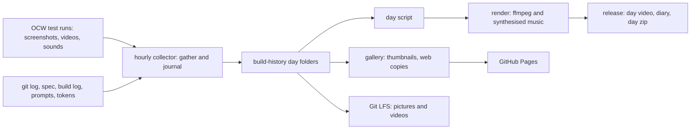

<!-- The README is generated: `make readme` (diary.py readme) fills this
     template (docs/readme/README.template.md) with the hero, the totals, the
     evolution strip (docs/readme/evolution.toml) and one section per build
     day from the day scripts and journals. Edit the template, not README.md. -->
# OCW Build Diary

**🚴 The art project of [Open Cycling World](https://github.com/newkit/OCW)** – the open-source indoor
cycling game ([▶ try it in your browser](https://newkit.github.io/OCW/) ·
[downloads](https://github.com/newkit/OCW/releases) ·
[repository](https://github.com/newkit/OCW)).
OCW is built by a human and a crowd of AI agents, day and night.
The OCW Build Diary keeps *everything* that was made on the way: every
screenshot, video, sound, log, commit, merge and test. From it, each build
day becomes a short video (title, a time-lapse of the whole day, the story in
chapters, today's features, the numbers), and the days are joined into one
growing diary video.

<p align="center"><a href="https://github.com/newkit/OCW-ART/releases/download/build-history/ocw-build-diary.mp4"></a></p>

**▶ [Watch the whole diary](https://github.com/newkit/OCW-ART/releases/download/build-history/ocw-build-diary.mp4)** ·
**[Browse the gallery](https://newkit.github.io/OCW-ART/)** (every picture and video, day by day) ·
[Day zips and videos](https://github.com/newkit/OCW-ART/releases/tag/build-history) ·
[The brief and the rules](docs/ART-PROJECT.md)

**17 build days** · **1432** commits · **11717** pictures · **332** videos · **20.93 billion** tokens · the diary video: 918.2 MB

## How the game grew

<table><tr><td align="center" valign="top" width="25%"><a href="https://newkit.github.io/OCW-ART/days/2026-11-11/#1"></a><br><sub>Day 1, 01:28 – capsule riders on a green test field</sub></td><td align="center" valign="top" width="25%"><a href="https://newkit.github.io/OCW-ART/days/2026-11-11/#93"></a><br><sub>Day 1 – the first real world: a road in Liechtenstein</sub></td><td align="center" valign="top" width="25%"><a href="https://newkit.github.io/OCW-ART/days/2026-11-12/#375"></a><br><sub>Day 2 – the glow-up: riders with bodies, a peloton climbs</sub></td><td align="center" valign="top" width="25%"><a href="https://newkit.github.io/OCW-ART/days/2026-11-12/#386"></a><br><sub>Day 2 – the Black Forest: the Schauinsland climb</sub></td></tr></table>
<table><tr><td align="center" valign="top" width="25%"><a href="https://newkit.github.io/OCW-ART/days/2026-11-13/#464"></a><br><sub>Day 3 – Tenerife, the Teide found at last</sub></td><td align="center" valign="top" width="25%"><a href="https://newkit.github.io/OCW-ART/days/2026-11-14/#1"></a><br><sub>Day 4 – Unicorn mode: flying over Vaduz</sub></td><td align="center" valign="top" width="25%"><a href="https://newkit.github.io/OCW-ART/days/2026-11-14/#364"></a><br><sub>Day 4 – the seasons: autumn above Vaduz</sub></td><td align="center" valign="top" width="25%"><a href="https://newkit.github.io/OCW-ART/days/2026-11-14/#158"></a><br><sub>Day 4 – the weather: a thunderstorm on Tenerife</sub></td></tr></table>
<table><tr><td align="center" valign="top" width="25%"><a href="https://newkit.github.io/OCW-ART/days/2026-11-14/#78"></a><br><sub>Day 4 – the browser app: the same ride in Chromium</sub></td><td align="center" valign="top" width="25%"><a href="https://newkit.github.io/OCW-ART/days/2026-11-15/#367"></a><br><sub>Day 5 – vegetation: vineyards above Vaduz</sub></td><td align="center" valign="top" width="25%"><a href="https://newkit.github.io/OCW-ART/days/2026-11-16/#254"></a><br><sub>Day 6 – signs of life: a phone in hand, VR goggles in the group</sub></td><td align="center" valign="top" width="25%"><a href="https://newkit.github.io/OCW-ART/days/2026-11-16/#3"></a><br><sub>Day 6 – J1: a side road blends into the main road</sub></td></tr></table>
<table><tr><td align="center" valign="top" width="25%"><a href="https://newkit.github.io/OCW-ART/days/2026-11-17/#381"></a><br><sub>Day 7 – hands: a palm, a thumb, four fingers</sub></td><td align="center" valign="top" width="25%"><a href="https://newkit.github.io/OCW-ART/days/2026-11-17/#355"></a><br><sub>Day 7 – the character editor: sixteen skin tones</sub></td><td align="center" valign="top" width="25%"><a href="https://newkit.github.io/OCW-ART/days/2026-11-18/#3"></a><br><sub>Day 8 – a bike computer map in the HUD, the route in magenta</sub></td><td align="center" valign="top" width="25%"><a href="https://newkit.github.io/OCW-ART/days/2026-11-18/#42"></a><br><sub>Day 8 – cracks and potholes, as bad as OpenStreetMap says</sub></td></tr></table>
<table><tr><td align="center" valign="top" width="25%"><a href="https://newkit.github.io/OCW-ART/days/2026-11-19/#131"></a><br><sub>Day 9 – lights for every rider at night</sub></td><td align="center" valign="top" width="25%"><a href="https://newkit.github.io/OCW-ART/days/2026-11-19/#1377"></a><br><sub>Day 9 – the browser app rides on an iPhone</sub></td><td align="center" valign="top" width="25%"><a href="https://newkit.github.io/OCW-ART/days/2026-11-20/#3"></a><br><sub>Day 10 – no tokens left: a crab turns out its pockets</sub></td><td align="center" valign="top" width="25%"><a href="https://newkit.github.io/OCW-ART/days/2026-11-21/#4"></a><br><sub>Day 11 – one key, one job: Delete and Page Down pick the exit</sub></td></tr></table>
<table><tr><td align="center" valign="top" width="25%"><a href="https://newkit.github.io/OCW-ART/days/2026-11-22/#19"></a><br><sub>Day 12 – lips that move while a rider is heard</sub></td><td align="center" valign="top" width="25%"><a href="https://newkit.github.io/OCW-ART/days/2026-11-23/#400"></a><br><sub>Day 13 – off the road: across a meadow, back to the road</sub></td><td align="center" valign="top" width="25%"><a href="https://newkit.github.io/OCW-ART/days/2026-11-23/#149"></a><br><sub>Day 13 – OCW Studio edits model files: a gizmo on the saddle</sub></td><td align="center" valign="top" width="25%"><a href="https://newkit.github.io/OCW-ART/days/2026-11-24/#3474"></a><br><sub>Day 14 – into the headset: a bike computer on the bars, in WebXR</sub></td></tr></table>
<table><tr><td align="center" valign="top" width="25%"><a href="https://newkit.github.io/OCW-ART/days/2026-11-24/#2948"></a><br><sub>Day 14 – the sensor bridge: a browser rides on the desktop&#x27;s trainer</sub></td><td align="center" valign="top" width="25%"><a href="https://newkit.github.io/OCW-ART/days/2026-11-25/#180"></a><br><sub>Day 15 – the sprint: out of the saddle, in the drops</sub></td><td align="center" valign="top" width="25%"><a href="https://newkit.github.io/OCW-ART/days/2026-11-25/#335"></a><br><sub>Day 15 – chin up: the bubble under every rider&#x27;s chin is gone</sub></td><td align="center" valign="top" width="25%"><a href="https://newkit.github.io/OCW-ART/days/2026-11-26/#179"></a><br><sub>Day 16 – the fifth world: Andorra la Vella, stone and slate</sub></td></tr></table>
<table><tr><td align="center" valign="top" width="25%"><a href="https://newkit.github.io/OCW-ART/days/2026-11-26/#159"></a><br><sub>Day 16 – the unicorn over the Hornisgrinde at golden hour</sub></td></tr></table>

## The build days

### Day 17 · 2026-11-27 — (the day's story is written at the end of the day)

[Gallery](https://newkit.github.io/OCW-ART/days/2026-11-27/) · day zip and video: at the end of the day

**0** commits · **0** merges · **0** pictures · **0** videos · **14 million** tokens · music: funk

### Day 16 · 2026-11-26 — A server of our own

*In which a flaky test turns out to be a 17 g stop, the accounts get hearts on Postgres, the game server moves into Frankfurt on Fly.io, Andorra becomes the fifth world – and the locals were right about the poles at Envalira.*

<table><tr><td align="center" valign="top"><a href="https://github.com/newkit/OCW-ART/releases/download/build-history/ocw-diary-day-16-2026-11-26.mp4"></a><br>▶ <a href="https://github.com/newkit/OCW-ART/releases/download/build-history/ocw-diary-day-16-2026-11-26.mp4">day video</a> (69.8 MB)</td><td align="center" valign="top"><a href="https://newkit.github.io/OCW-ART/days/2026-11-26/#30"></a></td><td align="center" valign="top"><a href="https://newkit.github.io/OCW-ART/days/2026-11-26/#135"></a></td><td align="center" valign="top"><a href="https://newkit.github.io/OCW-ART/days/2026-11-26/#113"></a></td></tr></table>

[Gallery](https://newkit.github.io/OCW-ART/days/2026-11-26/) · [▶ Day video](https://github.com/newkit/OCW-ART/releases/download/build-history/ocw-diary-day-16-2026-11-26.mp4) · [⇩ Day zip](https://github.com/newkit/OCW-ART/releases/download/build-history/ocw-build-history-2026-11-26.zip) (256.5 MB)

Data: [day script](days/2026-11-26.toml) · [journal](build-history/2026-11-26/journal.md) · [journal (JSON)](build-history/2026-11-26/journal.json) · [tokens](build-history/2026-11-26/tokens.json) · [pictures and videos](build-history/2026-11-26/) (Git LFS) · [⇩ gallery zip](https://github.com/newkit/OCW-ART/releases/download/build-history/gallery-2026-11-26.zip) (39.2 MB)

**111** commits · **36** merges · spec 6.03 → 6.66 · **247** pictures · **6** videos · **1.71 billion** tokens · music: synthwave

### Day 15 · 2026-11-25 — Chin up, 0.2.6

*In which two close junctions share one surface, a zebra crossing goes back where OSM has it, riders sprint in the drops, 0.2.6 ships with five J9 worlds – and the bubble under every rider's chin is gone.*

<table><tr><td align="center" valign="top"><a href="https://github.com/newkit/OCW-ART/releases/download/build-history/ocw-diary-day-15-2026-11-25.mp4"></a><br>▶ <a href="https://github.com/newkit/OCW-ART/releases/download/build-history/ocw-diary-day-15-2026-11-25.mp4">day video</a> (45.1 MB)</td><td align="center" valign="top"><a href="https://newkit.github.io/OCW-ART/days/2026-11-25/#126"></a></td><td align="center" valign="top"><a href="https://newkit.github.io/OCW-ART/days/2026-11-25/#329"></a></td><td align="center" valign="top"><a href="https://newkit.github.io/OCW-ART/days/2026-11-25/#367"></a></td></tr></table>

[Gallery](https://newkit.github.io/OCW-ART/days/2026-11-25/) · [▶ Day video](https://github.com/newkit/OCW-ART/releases/download/build-history/ocw-diary-day-15-2026-11-25.mp4) · [⇩ Day zip](https://github.com/newkit/OCW-ART/releases/download/build-history/ocw-build-history-2026-11-25.zip) (127 MB)

Data: [day script](days/2026-11-25.toml) · [journal](build-history/2026-11-25/journal.md) · [journal (JSON)](build-history/2026-11-25/journal.json) · [tokens](build-history/2026-11-25/tokens.json) · [pictures and videos](build-history/2026-11-25/) (Git LFS) · [⇩ gallery zip](https://github.com/newkit/OCW-ART/releases/download/build-history/gallery-2026-11-25.zip) (40.5 MB)

**48** commits · **10** merges · spec 5.81 → 6.02 · **367** pictures · **6** videos · **863 million** tokens · music: house

### Day 14 · 2026-11-24 — Into the headset

*In which the verges lose their notch, side paths join the road's side, the browser sheds 19 MB, the potholes stop being twins, a desktop lends its trainer to a browser – and the rider looks down at a bike computer on the bars, in VR.*

<table><tr><td align="center" valign="top"><a href="https://github.com/newkit/OCW-ART/releases/download/build-history/ocw-diary-day-14-2026-11-24.mp4"></a><br>▶ <a href="https://github.com/newkit/OCW-ART/releases/download/build-history/ocw-diary-day-14-2026-11-24.mp4">day video</a> (41 MB)</td><td align="center" valign="top"><a href="https://newkit.github.io/OCW-ART/days/2026-11-24/#25"></a></td><td align="center" valign="top"><a href="https://newkit.github.io/OCW-ART/days/2026-11-24/#2944"></a></td><td align="center" valign="top"><a href="https://newkit.github.io/OCW-ART/days/2026-11-24/#3478"></a></td></tr></table>

[Gallery](https://newkit.github.io/OCW-ART/days/2026-11-24/) · [▶ Day video](https://github.com/newkit/OCW-ART/releases/download/build-history/ocw-diary-day-14-2026-11-24.mp4) · [⇩ Day zip](https://github.com/newkit/OCW-ART/releases/download/build-history/ocw-build-history-2026-11-24.zip) (862.4 MB)

Data: [day script](days/2026-11-24.toml) · [journal](build-history/2026-11-24/journal.md) · [journal (JSON)](build-history/2026-11-24/journal.json) · [tokens](build-history/2026-11-24/tokens.json) · [pictures and videos](build-history/2026-11-24/) (Git LFS) · [⇩ gallery zip](https://github.com/newkit/OCW-ART/releases/download/build-history/gallery-2026-11-24.zip) (228.1 MB)

**51** commits · **13** merges · spec 5.65 → 5.80 · **3429** pictures · **73** videos · **960 million** tokens · music: acid

### Day 13 · 2026-11-23 — Off the road

*In which Tenerife admits it has no autumn, street lamps step out of the map and into the riders' way, the trees keep their leaves, OCW Studio learns to edit, the iPhone goes on a diet – and the unicorn lands in a meadow, where the road ends and the woods begin.*

<table><tr><td align="center" valign="top"><a href="https://github.com/newkit/OCW-ART/releases/download/build-history/ocw-diary-day-13-2026-11-23.mp4"></a><br>▶ <a href="https://github.com/newkit/OCW-ART/releases/download/build-history/ocw-diary-day-13-2026-11-23.mp4">day video</a> (63.2 MB)</td><td align="center" valign="top"><a href="https://newkit.github.io/OCW-ART/days/2026-11-23/#7"></a></td><td align="center" valign="top"><a href="https://newkit.github.io/OCW-ART/days/2026-11-23/#219"></a></td><td align="center" valign="top"><a href="https://newkit.github.io/OCW-ART/days/2026-11-23/#667"></a></td></tr></table>

[Gallery](https://newkit.github.io/OCW-ART/days/2026-11-23/) · [▶ Day video](https://github.com/newkit/OCW-ART/releases/download/build-history/ocw-diary-day-13-2026-11-23.mp4) · [⇩ Day zip](https://github.com/newkit/OCW-ART/releases/download/build-history/ocw-build-history-2026-11-23.zip) (557.5 MB)

Data: [day script](days/2026-11-23.toml) · [journal](build-history/2026-11-23/journal.md) · [journal (JSON)](build-history/2026-11-23/journal.json) · [tokens](build-history/2026-11-23/tokens.json) · [pictures and videos](build-history/2026-11-23/) (Git LFS) · [⇩ gallery zip](https://github.com/newkit/OCW-ART/releases/download/build-history/gallery-2026-11-23.zip) (69.7 MB)

**64** commits · **17** merges · spec 5.41 → 5.64 · **827** pictures · **11** videos · **1.36 billion** tokens · music: garage

### Day 12 · 2026-11-22 — Smooth, with bumps

*In which the riders move their lips, wet leaves bring them down, potholes kick the trainer, side roads leave from the kerb, the lamp posts step off the road, an iPhone stops restarting, the riders glide again – and 0.2.5 goes out.*

<table><tr><td align="center" valign="top"><a href="https://github.com/newkit/OCW-ART/releases/download/build-history/ocw-diary-day-12-2026-11-22.mp4"></a><br>▶ <a href="https://github.com/newkit/OCW-ART/releases/download/build-history/ocw-diary-day-12-2026-11-22.mp4">day video</a> (54.5 MB)</td><td align="center" valign="top"><a href="https://newkit.github.io/OCW-ART/days/2026-11-22/#1"></a></td><td align="center" valign="top"><a href="https://newkit.github.io/OCW-ART/days/2026-11-22/#120"></a></td><td align="center" valign="top"><a href="https://newkit.github.io/OCW-ART/days/2026-11-22/#366"></a></td></tr></table>

[Gallery](https://newkit.github.io/OCW-ART/days/2026-11-22/) · [▶ Day video](https://github.com/newkit/OCW-ART/releases/download/build-history/ocw-diary-day-12-2026-11-22.mp4) · [⇩ Day zip](https://github.com/newkit/OCW-ART/releases/download/build-history/ocw-build-history-2026-11-22.zip) (335.8 MB)

Data: [day script](days/2026-11-22.toml) · [journal](build-history/2026-11-22/journal.md) · [journal (JSON)](build-history/2026-11-22/journal.json) · [tokens](build-history/2026-11-22/tokens.json) · [pictures and videos](build-history/2026-11-22/) (Git LFS) · [⇩ gallery zip](https://github.com/newkit/OCW-ART/releases/download/build-history/gallery-2026-11-22.zip) (28 MB)

**46** commits · **12** merges · spec 5.24 → 5.40 · **377** pictures · **10** videos · **761 million** tokens · music: dub

### Day 11 · 2026-11-21 — The tokens come back

*In which the limit resets at nine, four agents start at once, the cursor keys stop doing two jobs, the host gets a Voice switch, crashes are heard from where they happen, and the browser sheds two thirds of its memory.*

<table><tr><td align="center" valign="top"><a href="https://github.com/newkit/OCW-ART/releases/download/build-history/ocw-diary-day-11-2026-11-21.mp4"></a><br>▶ <a href="https://github.com/newkit/OCW-ART/releases/download/build-history/ocw-diary-day-11-2026-11-21.mp4">day video</a> (28 MB)</td><td align="center" valign="top"><a href="https://newkit.github.io/OCW-ART/days/2026-11-21/#175"></a></td><td align="center" valign="top"><a href="https://newkit.github.io/OCW-ART/days/2026-11-21/#3"></a></td><td align="center" valign="top"><a href="https://newkit.github.io/OCW-ART/days/2026-11-21/#133"></a></td></tr></table>

[Gallery](https://newkit.github.io/OCW-ART/days/2026-11-21/) · [▶ Day video](https://github.com/newkit/OCW-ART/releases/download/build-history/ocw-diary-day-11-2026-11-21.mp4) · [⇩ Day zip](https://github.com/newkit/OCW-ART/releases/download/build-history/ocw-build-history-2026-11-21.zip) (56.3 MB)

Data: [day script](days/2026-11-21.toml) · [journal](build-history/2026-11-21/journal.md) · [journal (JSON)](build-history/2026-11-21/journal.json) · [tokens](build-history/2026-11-21/tokens.json) · [pictures and videos](build-history/2026-11-21/) (Git LFS) · [⇩ gallery zip](https://github.com/newkit/OCW-ART/releases/download/build-history/gallery-2026-11-21.zip) (11.9 MB)

**15** commits · **5** merges · spec 5.18 → 5.23 · **180** pictures · **3** videos · **321 million** tokens · music: trance

### Day 10 · 2026-11-20 — No tokens left

*In which nothing is built at all: the weekly limit is reached, and a crab turns out its pockets to prove it.*

<table><tr><td align="center" valign="top"><a href="https://github.com/newkit/OCW-ART/releases/download/build-history/ocw-diary-day-10-2026-11-20.mp4"></a><br>▶ <a href="https://github.com/newkit/OCW-ART/releases/download/build-history/ocw-diary-day-10-2026-11-20.mp4">day video</a> (4.2 MB)</td><td align="center" valign="top"><a href="https://newkit.github.io/OCW-ART/days/2026-11-20/#3"></a></td><td align="center" valign="top"><a href="https://newkit.github.io/OCW-ART/days/2026-11-20/#4"></a></td></tr></table>

[Gallery](https://newkit.github.io/OCW-ART/days/2026-11-20/) · [▶ Day video](https://github.com/newkit/OCW-ART/releases/download/build-history/ocw-diary-day-10-2026-11-20.mp4) · [⇩ Day zip](https://github.com/newkit/OCW-ART/releases/download/build-history/ocw-build-history-2026-11-20.zip) (4.1 MB)

Data: [day script](days/2026-11-20.toml) · [journal](build-history/2026-11-20/journal.md) · [journal (JSON)](build-history/2026-11-20/journal.json) · [tokens](build-history/2026-11-20/tokens.json) · [incidents](build-history/2026-11-20/incidents.md) · [pictures and videos](build-history/2026-11-20/) (Git LFS) · [⇩ gallery zip](https://github.com/newkit/OCW-ART/releases/download/build-history/gallery-2026-11-20.zip) (100.3 kB)

**0** commits · **0** merges · **4** pictures · **1** videos · music: ambient

### Day 9 · 2026-11-19 — Lights on, legs on

*In which the riders' legs finally join their bodies, every bike gets a light at night, the maps name the peaks, helmets, lamps and the unicorn move into model files, and the browser learns to ride on a phone.*

<table><tr><td align="center" valign="top"><a href="https://github.com/newkit/OCW-ART/releases/download/build-history/ocw-diary-day-09-2026-11-19.mp4"></a><br>▶ <a href="https://github.com/newkit/OCW-ART/releases/download/build-history/ocw-diary-day-09-2026-11-19.mp4">day video</a> (65.4 MB)</td><td align="center" valign="top"><a href="https://newkit.github.io/OCW-ART/days/2026-11-19/#253"></a></td><td align="center" valign="top"><a href="https://newkit.github.io/OCW-ART/days/2026-11-19/#636"></a></td><td align="center" valign="top"><a href="https://newkit.github.io/OCW-ART/days/2026-11-19/#1300"></a></td></tr></table>

[Gallery](https://newkit.github.io/OCW-ART/days/2026-11-19/) · [▶ Day video](https://github.com/newkit/OCW-ART/releases/download/build-history/ocw-diary-day-09-2026-11-19.mp4) · [⇩ Day zip](https://github.com/newkit/OCW-ART/releases/download/build-history/ocw-build-history-2026-11-19.zip) (793.8 MB)

Data: [day script](days/2026-11-19.toml) · [journal](build-history/2026-11-19/journal.md) · [journal (JSON)](build-history/2026-11-19/journal.json) · [tokens](build-history/2026-11-19/tokens.json) · [pictures and videos](build-history/2026-11-19/) (Git LFS) · [⇩ gallery zip](https://github.com/newkit/OCW-ART/releases/download/build-history/gallery-2026-11-19.zip) (84.6 MB)

**95** commits · **33** merges · spec 4.88 → 5.17 · **1380** pictures · **15** videos · **1.59 billion** tokens · music: electro

### Day 8 · 2026-11-18 — A map in the corner, cracks in the road

*In which the HUD gets a bike computer that names its towns, the roads crack as badly as OpenStreetMap says, the forks finally point forward – and every ride lands in one folder, ready for Strava, set up or not.*

<table><tr><td align="center" valign="top"><a href="https://github.com/newkit/OCW-ART/releases/download/build-history/ocw-diary-day-08-2026-11-18.mp4"></a><br>▶ <a href="https://github.com/newkit/OCW-ART/releases/download/build-history/ocw-diary-day-08-2026-11-18.mp4">day video</a> (64.1 MB)</td><td align="center" valign="top"><a href="https://newkit.github.io/OCW-ART/days/2026-11-18/#7"></a></td><td align="center" valign="top"><a href="https://newkit.github.io/OCW-ART/days/2026-11-18/#448"></a></td><td align="center" valign="top"><a href="https://newkit.github.io/OCW-ART/days/2026-11-18/#951"></a></td></tr></table>

[Gallery](https://newkit.github.io/OCW-ART/days/2026-11-18/) · [▶ Day video](https://github.com/newkit/OCW-ART/releases/download/build-history/ocw-diary-day-08-2026-11-18.mp4) · [⇩ Day zip](https://github.com/newkit/OCW-ART/releases/download/build-history/ocw-build-history-2026-11-18.zip) (236.4 MB)

Data: [day script](days/2026-11-18.toml) · [journal](build-history/2026-11-18/journal.md) · [journal (JSON)](build-history/2026-11-18/journal.json) · [tokens](build-history/2026-11-18/tokens.json) · [pictures and videos](build-history/2026-11-18/) (Git LFS) · [⇩ gallery zip](https://github.com/newkit/OCW-ART/releases/download/build-history/gallery-2026-11-18.zip) (52.8 MB)

**75** commits · **28** merges · spec 4.67 → 4.87 · **942** pictures · **9** videos · **883 million** tokens · music: liquid-dnb

### Day 7 · 2026-11-17 — Faces, hands and a headset on a weak charger

*In which the riders get faces, skin tones and real hands, the bike stand puts a price on speed, voices learn their range – and Weela rides VR until its battery gives up.*

<table><tr><td align="center" valign="top"><a href="https://github.com/newkit/OCW-ART/releases/download/build-history/ocw-diary-day-07-2026-11-17.mp4"></a><br>▶ <a href="https://github.com/newkit/OCW-ART/releases/download/build-history/ocw-diary-day-07-2026-11-17.mp4">day video</a> (77.2 MB)</td><td align="center" valign="top"><a href="https://newkit.github.io/OCW-ART/days/2026-11-17/#186"></a></td><td align="center" valign="top"><a href="https://newkit.github.io/OCW-ART/days/2026-11-17/#368"></a></td><td align="center" valign="top"><a href="https://newkit.github.io/OCW-ART/days/2026-11-17/#943"></a></td></tr></table>

[Gallery](https://newkit.github.io/OCW-ART/days/2026-11-17/) · [▶ Day video](https://github.com/newkit/OCW-ART/releases/download/build-history/ocw-diary-day-07-2026-11-17.mp4) · [⇩ Day zip](https://github.com/newkit/OCW-ART/releases/download/build-history/ocw-build-history-2026-11-17.zip) (336.3 MB)

Data: [day script](days/2026-11-17.toml) · [journal](build-history/2026-11-17/journal.md) · [journal (JSON)](build-history/2026-11-17/journal.json) · [tokens](build-history/2026-11-17/tokens.json) · [pictures and videos](build-history/2026-11-17/) (Git LFS) · [⇩ gallery zip](https://github.com/newkit/OCW-ART/releases/download/build-history/gallery-2026-11-17.zip) (44.8 MB)

**78** commits · **23** merges · spec 4.39 → 4.68 · **1039** pictures · **8** videos · **2.07 billion** tokens · music: melodic-deep-house

### Day 6 · 2026-11-16 — Moving day, a photographer and a headset at midnight

*In which the coordinator moves house, a photographer with a drone joins every ride, voices get their own server – and a headset waits on a Windows desk.*

<table><tr><td align="center" valign="top"><a href="https://github.com/newkit/OCW-ART/releases/download/build-history/ocw-diary-day-06-2026-11-16.mp4"></a><br>▶ <a href="https://github.com/newkit/OCW-ART/releases/download/build-history/ocw-diary-day-06-2026-11-16.mp4">day video</a> (64.3 MB)</td><td align="center" valign="top"><a href="https://newkit.github.io/OCW-ART/days/2026-11-16/#1"></a></td><td align="center" valign="top"><a href="https://newkit.github.io/OCW-ART/days/2026-11-16/#208"></a></td><td align="center" valign="top"><a href="https://newkit.github.io/OCW-ART/days/2026-11-16/#251"></a></td></tr></table>

[Gallery](https://newkit.github.io/OCW-ART/days/2026-11-16/) · [▶ Day video](https://github.com/newkit/OCW-ART/releases/download/build-history/ocw-diary-day-06-2026-11-16.mp4) · [⇩ Day zip](https://github.com/newkit/OCW-ART/releases/download/build-history/ocw-build-history-2026-11-16.zip) (462.4 MB)

Data: [day script](days/2026-11-16.toml) · [journal](build-history/2026-11-16/journal.md) · [journal (JSON)](build-history/2026-11-16/journal.json) · [tokens](build-history/2026-11-16/tokens.json) · [pictures and videos](build-history/2026-11-16/) (Git LFS) · [⇩ gallery zip](https://github.com/newkit/OCW-ART/releases/download/build-history/gallery-2026-11-16.zip) (43.8 MB)

**129** commits · **30** merges · spec 3.75 → 4.38 · **667** pictures · **1** videos · **1.74 billion** tokens · music: darkchip

### Day 5 · 2026-11-15 — Bananas, a second pair of eyes and a house move

*In which the hills grow vineyards and banana groves, riders learn to put a foot down – and the whole diary packs its bags.*

<table><tr><td align="center" valign="top"><a href="https://github.com/newkit/OCW-ART/releases/download/build-history/ocw-diary-day-05-2026-11-15.mp4"></a><br>▶ <a href="https://github.com/newkit/OCW-ART/releases/download/build-history/ocw-diary-day-05-2026-11-15.mp4">day video</a> (61.1 MB)</td><td align="center" valign="top"><a href="https://newkit.github.io/OCW-ART/days/2026-11-15/#324"></a></td><td align="center" valign="top"><a href="https://newkit.github.io/OCW-ART/days/2026-11-15/#524"></a></td><td align="center" valign="top"><a href="https://newkit.github.io/OCW-ART/days/2026-11-15/#689"></a></td></tr></table>

[Gallery](https://newkit.github.io/OCW-ART/days/2026-11-15/) · [▶ Day video](https://github.com/newkit/OCW-ART/releases/download/build-history/ocw-diary-day-05-2026-11-15.mp4) · [⇩ Day zip](https://github.com/newkit/OCW-ART/releases/download/build-history/ocw-build-history-2026-11-15.zip) (502.8 MB)

Data: [day script](days/2026-11-15.toml) · [journal](build-history/2026-11-15/journal.md) · [journal (JSON)](build-history/2026-11-15/journal.json) · [tokens](build-history/2026-11-15/tokens.json) · [incidents](build-history/2026-11-15/incidents.md) · [pictures and videos](build-history/2026-11-15/) (Git LFS) · [⇩ gallery zip](https://github.com/newkit/OCW-ART/releases/download/build-history/gallery-2026-11-15.zip) (42.5 MB)

**149** commits · **39** merges · spec 3.36 → 3.74 · **731** pictures · **9** videos · **1.66 billion** tokens · music: chiptune

### Day 4 · 2026-11-14 — The weather, the seasons and the 404

*In which Storm Lothar returns, the leaves turn, the browser learns to sing – and one URL leads nowhere.*

<table><tr><td align="center" valign="top"><a href="https://github.com/newkit/OCW-ART/releases/download/build-history/ocw-diary-day-04-2026-11-14.mp4"></a><br>▶ <a href="https://github.com/newkit/OCW-ART/releases/download/build-history/ocw-diary-day-04-2026-11-14.mp4">day video</a> (134.4 MB)</td><td align="center" valign="top"><a href="https://newkit.github.io/OCW-ART/days/2026-11-14/#10"></a></td><td align="center" valign="top"><a href="https://newkit.github.io/OCW-ART/days/2026-11-14/#392"></a></td><td align="center" valign="top"><a href="https://newkit.github.io/OCW-ART/days/2026-11-14/#498"></a></td></tr></table>

[Gallery](https://newkit.github.io/OCW-ART/days/2026-11-14/) · [▶ Day video](https://github.com/newkit/OCW-ART/releases/download/build-history/ocw-diary-day-04-2026-11-14.mp4) · [⇩ Day zip](https://github.com/newkit/OCW-ART/releases/download/build-history/ocw-build-history-2026-11-14.zip) (1.3 GB)

Data: [day script](days/2026-11-14.toml) · [journal](build-history/2026-11-14/journal.md) · [journal (JSON)](build-history/2026-11-14/journal.json) · [tokens](build-history/2026-11-14/tokens.json) · [pictures and videos](build-history/2026-11-14/) (Git LFS) · [⇩ gallery zip](https://github.com/newkit/OCW-ART/releases/download/build-history/gallery-2026-11-14.zip) (32.7 MB)

**160** commits · **49** merges · spec 2.66 → 3.35 · **535** pictures · **39** videos · **3.18 billion** tokens · music: chiptune

### Day 3 · 2026-11-13 — The day of the missing volcano

*In which, on Friday the 13th, a sun rises, a unicorn flies, and the Teide plays hide and seek for seven hours.*

<table><tr><td align="center" valign="top"><a href="https://github.com/newkit/OCW-ART/releases/download/build-history/ocw-diary-day-03-2026-11-13.mp4"></a><br>▶ <a href="https://github.com/newkit/OCW-ART/releases/download/build-history/ocw-diary-day-03-2026-11-13.mp4">day video</a> (70.2 MB)</td><td align="center" valign="top"><a href="https://newkit.github.io/OCW-ART/days/2026-11-13/#20"></a></td><td align="center" valign="top"><a href="https://newkit.github.io/OCW-ART/days/2026-11-13/#388"></a></td><td align="center" valign="top"><a href="https://newkit.github.io/OCW-ART/days/2026-11-13/#472"></a></td></tr></table>

[Gallery](https://newkit.github.io/OCW-ART/days/2026-11-13/) · [▶ Day video](https://github.com/newkit/OCW-ART/releases/download/build-history/ocw-diary-day-03-2026-11-13.mp4) · [⇩ Day zip](https://github.com/newkit/OCW-ART/releases/download/build-history/ocw-build-history-2026-11-13.zip) (472.5 MB)

Data: [day script](days/2026-11-13.toml) · [journal](build-history/2026-11-13/journal.md) · [journal (JSON)](build-history/2026-11-13/journal.json) · [tokens](build-history/2026-11-13/tokens.json) · [pictures and videos](build-history/2026-11-13/) (Git LFS) · [⇩ gallery zip](https://github.com/newkit/OCW-ART/releases/download/build-history/gallery-2026-11-13.zip) (23 MB)

**143** commits · **43** merges · spec 2.30 → 2.64 · **449** pictures · **29** videos · **1.97 billion** tokens · music: lofi

### Day 2 · 2026-11-12 — The night shift, the glow-up and a peloton across three operating systems

*In which the agents work through the night and the capsules finally get bodies.*

<table><tr><td align="center" valign="top"><a href="https://github.com/newkit/OCW-ART/releases/download/build-history/ocw-diary-day-02-2026-11-12.mp4"></a><br>▶ <a href="https://github.com/newkit/OCW-ART/releases/download/build-history/ocw-diary-day-02-2026-11-12.mp4">day video</a> (42.1 MB)</td><td align="center" valign="top"><a href="https://newkit.github.io/OCW-ART/days/2026-11-12/#16"></a></td><td align="center" valign="top"><a href="https://newkit.github.io/OCW-ART/days/2026-11-12/#132"></a></td><td align="center" valign="top"><a href="https://newkit.github.io/OCW-ART/days/2026-11-12/#381"></a></td></tr></table>

[Gallery](https://newkit.github.io/OCW-ART/days/2026-11-12/) · [▶ Day video](https://github.com/newkit/OCW-ART/releases/download/build-history/ocw-diary-day-02-2026-11-12.mp4) · [⇩ Day zip](https://github.com/newkit/OCW-ART/releases/download/build-history/ocw-build-history-2026-11-12.zip) (311.9 MB)

Data: [day script](days/2026-11-12.toml) · [journal](build-history/2026-11-12/journal.md) · [journal (JSON)](build-history/2026-11-12/journal.json) · [tokens](build-history/2026-11-12/tokens.json) · [pictures and videos](build-history/2026-11-12/) (Git LFS) · [⇩ gallery zip](https://github.com/newkit/OCW-ART/releases/download/build-history/gallery-2026-11-12.zip) (23.5 MB)

**113** commits · **27** merges · spec 2.8 → 2.29 · **383** pictures · **63** videos · **873 million** tokens · music: funk

### Day 1 · 2026-11-11 — From five capsules to the Principality of Liechtenstein

*In which a spec is written at 00:38 and the riders are mostly capsules.*

<table><tr><td align="center" valign="top"><a href="https://github.com/newkit/OCW-ART/releases/download/build-history/ocw-diary-day-01-2026-11-11.mp4"></a><br>▶ <a href="https://github.com/newkit/OCW-ART/releases/download/build-history/ocw-diary-day-01-2026-11-11.mp4">day video</a> (33 MB)</td><td align="center" valign="top"><a href="https://newkit.github.io/OCW-ART/days/2026-11-11/#1"></a></td><td align="center" valign="top"><a href="https://newkit.github.io/OCW-ART/days/2026-11-11/#76"></a></td><td align="center" valign="top"><a href="https://newkit.github.io/OCW-ART/days/2026-11-11/#186"></a></td></tr></table>

[Gallery](https://newkit.github.io/OCW-ART/days/2026-11-11/) · [▶ Day video](https://github.com/newkit/OCW-ART/releases/download/build-history/ocw-diary-day-01-2026-11-11.mp4) · [⇩ Day zip](https://github.com/newkit/OCW-ART/releases/download/build-history/ocw-build-history-2026-11-11.zip) (138.1 MB)

Data: [day script](days/2026-11-11.toml) · [journal](build-history/2026-11-11/journal.md) · [journal (JSON)](build-history/2026-11-11/journal.json) · [tokens](build-history/2026-11-11/tokens.json) · [pictures and videos](build-history/2026-11-11/) (Git LFS) · [⇩ gallery zip](https://github.com/newkit/OCW-ART/releases/download/build-history/gallery-2026-11-11.zip) (9.2 MB)

**155** commits · **35** merges · spec 1.3 → 2.6 · **160** pictures · **49** videos · **971 million** tokens · music: synthwave

## How it is made



1. **Collect** (every hour, a systemd timer): every picture, video, sound and
   log of OCW's test runs is gathered into `build-history/DAY/`, with its
   capture time; the journal adds commits, merges, spec versions, builds,
   prompts, token usage, incidents and the day's features. All text is
   masked (no hosts, users, home paths, e-mail or private addresses).
2. **Write** the day's story: `days/DAY.toml` picks the chapters, shots, captions
   and jokes from the journal and the contact sheets – facts only.
3. **Render** the day video with ffmpeg: Ken Burns stills, clips, splits,
   sticker notes, a time-lapse with a running clock and the commit log, the
   features roll and the end card; music and sound effects are synthesised
   by the tool (a style per day). Then the diary is rebuilt.
4. **Publish**: the day zip and the videos go to the release, the gallery to
   GitHub Pages, the pictures and videos into Git LFS, and this README is
   regenerated.

## Layout

```
OCW-ART/
├── diary.py               # the command line (diary.py --help)
├── ocwart/                # the Python package: core, mask, archive, prompts, incidents,
│                          # agents, features, journal, render, subtitles, music, sfx,
│                          # publish, gallery, lfs, readme, collect, cli
├── bin/collect.sh         # the hourly collector (run by the systemd user timer)
├── systemd/               # ocw-art-collect.service / .timer
├── site/                  # the gallery's templates (page, CSS, lightbox script)
├── .github/workflows/     # gallery.yml: deploys the gallery to GitHub Pages
├── days/YYYY-MM-DD.toml   # the day scripts (story, shots, jokes)
├── assets/                # the OCW logo and Fira Mono (copies from OCW)
├── docs/ART-PROJECT.md    # the specification; docs/readme/ this README's template
├── tests/                 # unit tests (hermetic: fixture archives and repositories)
└── build-history/         # the archive (masked text tracked, media in LFS or local)
```

## All the data

| What | Where |
|---|---|
| Every picture and video, day by day | [the gallery](https://newkit.github.io/OCW-ART/) · in Git LFS under [`build-history/`](build-history/) |
| The diary video, the day videos, the day zips (full size) and the gallery zips | the release [`build-history`](https://github.com/newkit/OCW-ART/releases/tag/build-history) (checksums: [SHA256SUMS](https://github.com/newkit/OCW-ART/releases/download/build-history/SHA256SUMS)) |
| Each day's story: chapters, shots, captions | [`days/`](days/) – one `DAY.toml` per day |
| Each day's journal: commits, merges, spec versions, builds, prompts, incidents, features | `build-history/DAY/journal.md` and `journal.json` (linked under each day above) |
| Token usage per day and agent | `build-history/DAY/tokens.json` (linked under each day above) |
| The game itself: code, specification, releases | [OCW](https://github.com/newkit/OCW) · [SPECIFICATION.md](https://github.com/newkit/OCW/blob/main/SPECIFICATION.md) · [releases](https://github.com/newkit/OCW/releases) · [play in the browser](https://newkit.github.io/OCW/) |
| How this diary is made, and its rules | [docs/ART-PROJECT.md](docs/ART-PROJECT.md) |

## Where the media live

| Where | What |
|---|---|
| `build-history/` on the dev machine | the archive: everything, full size |
| Git LFS of this repository | the day folders' pictures and videos, one commit per day, within a 9 GiB budget of the free plan's 10 GiB ([§2.8](docs/ART-PROJECT.md#28-pictures-and-videos-in-git-lfs-decided-by-the-user-2026-11-15)) |
| the release [`build-history`](https://github.com/newkit/OCW-ART/releases/tag/build-history) | one zip per finished day (full size, text masked), the day videos, the diary, the gallery's zips |
| [GitHub Pages](https://newkit.github.io/OCW-ART/) | the gallery: thumbnails, web copies and poster frames, under 900 MB ([§6](docs/ART-PROJECT.md#6-the-gallery-decided-by-the-user-2026-11-15)) |

Git tracks the archive's masked text (`index.md`, `SHA256SUMS`, per day
`journal.md`, `journal.json`, `tokens.json`, `incidents.md`); the media go
only into LFS. Never in git or LFS: the day zips, the diary videos and the
work files (`.work/`).

**Clone without the media** (the code, the day scripts, the journals) – this
saves the free LFS bandwidth of 10 GiB a month:

```bash
GIT_LFS_SKIP_SMUDGE=1 git clone https://github.com/newkit/OCW-ART.git
# or once per machine: git lfs install --skip-smudge
git lfs pull --include "build-history/2026-11-14/*"   # later: one day's media
```

## Setup and commands

Needs Python 3.11+, ffmpeg with libass, git-lfs, `zip`, the Lato font and
`gh` (logged in). `make deps` checks them, installs ffmpeg, git-lfs and zip
(apt or dnf; on macOS it prints the `brew` line) and runs `git lfs install`.
The tool reads OCW from a checkout next to this one (`../OCW`; `OCW_REPO` or
`ocw_repo` in a git-ignored `ocw-art.toml` point elsewhere).

```bash
git clone https://github.com/newkit/OCW.git OCW
GIT_LFS_SKIP_SMUDGE=1 git clone https://github.com/newkit/OCW-ART.git OCW-ART
cd OCW-ART && make deps && make help

make gather DAY=2026-11-13    # collect the day's media and logs, write the journal
make sheets DAY=2026-11-13    # contact sheets for writing days/DAY.toml
make render DAY=2026-11-13    # the day video
make diary                    # the diary video
make publish DAY=2026-11-13   # day zip + videos → release, the gallery, this README
make gallery                  # the gallery locally (make gallery-preview)
make readme                   # regenerate this README
make lfs-check                # the LFS total, the budget, the days left
make lfs-commit DAY=2026-11-13 && make lfs-push   # the day's media → Git LFS
make check                    # tracked text, README and media names masked?
make test                     # unit tests
make install-timer            # the hourly collector (systemd user timer)
```

The art project lived in OCW until 2026-11-15
([docs/ART-PROJECT.md §5.2](docs/ART-PROJECT.md#52-history-from-ocw-to-ocw-art-2026-11-15)).

## Licences and credits

- **Code** (`diary.py`, `ocwart/`, `bin/`, `site/`, the tests, the Makefile,
  the units and the workflow): MIT OR Apache-2.0, like OCW
  ([LICENSE-MIT](LICENSE-MIT), [LICENSE-APACHE](LICENSE-APACHE)).
- **Fonts:** Fira Mono (SIL Open Font License 1.1, `assets/fonts/OFL.txt`;
  © 2012-2015 The Mozilla Foundation and Telefonica S.A.); Lato (SIL OFL 1.1,
  from the system).
- **Map data:** the world renders contain OpenStreetMap-derived data,
  **© [OpenStreetMap contributors](https://www.openstreetmap.org/copyright)**
  (ODbL). The attribution rules of OCW and of each of its assets apply
  (OCW's spec §4.6).
- **Music and sound effects:** synthesised by the tool itself – no samples.
- **The pictures and videos** are renders of Open Cycling World, made while
  building it.
